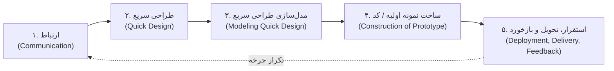

# 📐 مدل‌سازی چابک و جریان آن (Agile Modeling)

> [!info] تعریف کلیدی
> **مدل‌سازی چابک (Agile Modeling)** مجموعه‌ای از اصول و شیوه‌ها (مطرح‌شده توسط **اسکات آملر** و **ران جفریس**) است که نشان می‌دهد چگونه می‌توان در پروژه‌های چابک، مدل‌های تحلیل و طراحی سبک، سریع و مؤثر تولید کرد.

## 🖼️ جریان نقش مدل‌سازی در توسعه نرم‌افزار (تصویر ۴-۶ جزوه / Figure 6.4)
![[fig_6_4_modeling_role.png]]

### تشریح گام‌های جریان تصویر ۴-۶ جزوه:
1. **ارتباط (Communication):** درک نیازهای ذی‌نفعان و تعریف محدوده تکرار فعلی.
2. **طراحی سریع (Quick Design):** ترسیم ایده کلی راه‌حل و معماری سطح بالا در زمان کوتاه.
3. **مدل‌سازی طراحی سریع (Modeling Quick Design):** تبدیل ایده طراحی سریع به مدل‌های سبک تحلیل و طراحی برای روشن شدن جزئیات پیش از کدنویسی.
4. **ساخت [[مدل نمونه‌سازی (Prototyping)|نمونه اولیه]] (Construction of Prototype):** پیاده‌سازی و تولید نسخه اجرایی بر اساس مدل طراحی.
5. **استقرار، تحویل و بازخورد (Deployment, Delivery, Feedback):** ارائه خروجی به کاربر و استفاده از بازخورد او برای آغاز دور بعدی ارتباط.

## 📜 اصول کلیدی مدل‌سازی چابک (بخش ۳-۲-۶ جزوه)
1. **هدف اولیه ساخت نرم‌افزار است، نه ساخت مدل:** مدل فقط ابزاری برای درک بهتر و ارتباط است، نه هدف نهایی.
2. **بیش از نیاز خود مدل ایجاد نکنید (Travel Light):** از تولید مدل‌های سنگین و غیرضروری که نگهداری آن‌ها زمان‌بر است خودداری کنید.
3. **ساده‌ترین مدل را تولید کنید:** مدلی بسازید که مسئله را حل کند و نیازمندی‌ها را برآورده سازد، نه پیچیده‌تر.
4. **مدل‌ها را با سیستم موردنظر سازگار کنید:** مدل‌ها باید قابل تغییر و انعطاف‌پذیر باشند.
5. **مدل‌های مفید بسازید، انتظار مدل بی‌نقص نداشته باشید:** هدف کامل بودن مطلق مدل نیست، بلکه مفید بودن آن برای شروع ساخت است.
6. **در چیدمان مدل تعصبات را کنار بگذارید:** محتوای مدل و ارتباط شفاف آن بسیار مهم‌تر از وسواس روی ظاهر و چیدمان گرافیکی آن است.
7. **به غریزه خود اعتماد کنید:** اگر تجربه‌تان می‌گوید مدلی به خوبی کار نمی‌کند (حتی اگر از نظر تئوری بی‌نقص به نظر برسد)، باید در آن بازنگری کنید.

## 🔗 ارتباط با سایر مفاهیم
* [[فرآیند توسعه چابک (Agile)]]
* [[برنامه‌سازی مفرط (XP)]]
* [[اصول راهنمای کار مهندسی نرم‌افزار]]
* [[فرایند و جریان اطلاعات در طراحی نرم‌افزار]]

> [!warning] نکات امتحانی
> * طبق بخش ۳-۲-۶ جزوه، **هدف اصلی مدل‌سازی چابک** چیست؟ ساخت نرم‌افزار کارا (مدل فقط وسیله‌ای برای درک و ارتباط است).
> * در جریان تصویر ۴-۶ جزوه، بلافاصله پس از `Quick Design` مرحله `Modeling Quick Design` قرار دارد که مستقیماً به `Construction of Prototype` منتهی می‌شود.
