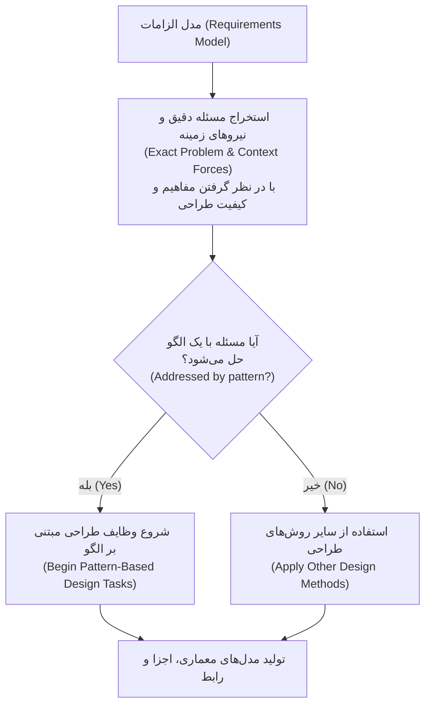

# 🧩 طراحی مبتنی بر الگو (Pattern-Based Design)

> [!info] تعریف کلیدی
> **الگوی طراحی (Design Pattern)** یک راه‌حل اثبات‌شده، قابل استفاده مجدد و استاندارد برای یک **مسئله تکراری طراحی** در یک **زمینه (Context)** مشخص است.

## 📐 قانون سه‌قسمتی الگوی طراحی (Three-Part Rule)
هر الگوی طراحی معتبر از سه بخش اصلی تشکیل می‌شود:
1. **زمینه (Context):** شرایط و محیطی که مسئله در آن رخ می‌دهد.
2. **مسئله (Problem):** چالش طراحی و **سیستم نیروها (System of Forces)** (محدودیت‌ها و عوامل متضاد) که باید در آن زمینه حل شوند.
3. **راه‌حل (Solution):** ساختار و پیکربندی اجزا و روابطی که نیروهای موجود را متعادل کرده و مسئله را حل می‌کند.

## 🖼️ جریان تصمیم‌گیری طراحی مبتنی بر الگو در زمینه (تصویر ۱-۱۴ جزوه / Figure 14.1)
![[fig_14_1_pattern_design.png]]

### تشریح جریان تصویر ۱-۱۴ جزوه:
1. با شروع مرحله طراحی از روی **[[مدیریت نیازمندی‌ها|مدل الزامات]]**، مهندس با تکیه بر مفاهیم طراحی و ویژگی‌های کیفیت، **مسئله دقیق و نیروهای زمینه** را استخراج می‌کند.
2. سپس بررسی می‌شود که آیا برای این مسئله **الگوی طراحی مناسبی** وجود دارد یا خیر (`Addressed by pattern?`):
   - **اگر پاسخ بله باشد:** وظایف طراحی مبتنی بر الگو اجرا شده و الگوی موجود با نیاز پروژه تطبیق داده می‌شود.
   - **اگر پاسخ خیر باشد:** از روش‌ها و نمادگذاری‌های معمول طراحی برای ساخت راه‌حل اختصاصی استفاده می‌شود.
3. در نهایت خروجی هر دو مسیر به شکل‌گیری مدل‌های **معماری، اجزا و رابط** منتهی می‌شود.

## 🔗 ارتباط با سایر مفاهیم
* [[فرایند و جریان اطلاعات در طراحی نرم‌افزار]]
* [[مفاهیم بنیادین و اصول مدل‌سازی طراحی]]
* [[اصول راهنمای کار مهندسی نرم‌افزار]]

> [!warning] نکات امتحانی
> * **اجزای قانون سه‌قسمتی الگو در جزوه:** ۱. زمینه (Context) ۲. مشکل (Problem) ۳. راه‌حل (Solution) به همراه سیستم نیروها (System of Forces).
> * طراحی مبتنی بر الگو مصداق عملی **اصل ششم راهنمای کار** («تلاش برای یافتن الگو») و **[[چهار گام حل مسئله و اصول دیوید هوکر|اصل ششم هوکر]]** («برنامه‌ریزی برای استفاده مجدد») است.
