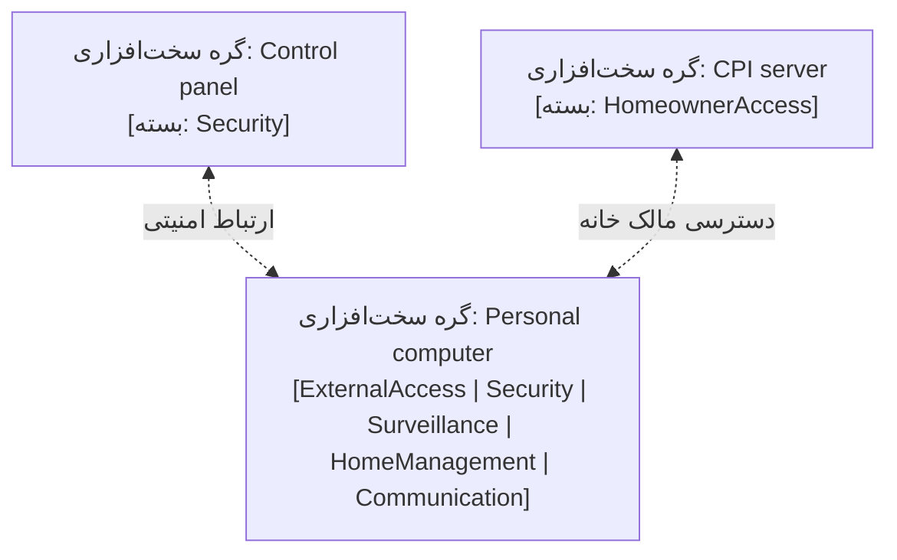

# 🏛️ طراحی معماری و نمودار استقرار UML

> [!info] تعریف کلیدی
> **طراحی معماری (Architectural Design)** ساختار کلان سیستم را تعیین می‌کند و **مدل استقرار (Deployment Model)** نشان می‌دهد که اجزا و زیرسیستم‌های نرم‌افزاری چگونه بر روی گره‌های سخت‌افزاری و محیط محاسباتی واقعی توزیع و مستقر می‌شوند.

## 🖼️ نمودار استقرار UML در جزوه (تصویر ۷-۹ / Figure 9.7)
![[fig_9_7_deployment_diagram.png]]

### تشریح جریان و اجزای نمودار استقرار (مثال سیستم SafeHome در جزوه):
نمودار استقرار UML (شکل ۷-۹ جزوه) معماری فیزیکی استقرار سه زیرسیستم اصلی را روی سه گره سخت‌افزاری (`Nodes`) نشان می‌دهد:

1. **گره صفحه کنترل (`Control panel`):**
   - شامل بسته نرم‌افزاری **`Security`** است که وظایف کنترل امنیتی و حسگرهای محلی را اجرا می‌کند.
2. **گره سرور مرکزی (`CPI server`):**
   - شامل بسته نرم‌افزاری **`HomeownerAccess`** است که دسترسی از راه دور و مدیریت حساب کاربران را فراهم می‌کند.
3. **گره رایانه شخصی (`Personal computer`):**
   - شامل ۵ بسته نرم‌افزاری **`ExternalAccess`**، **`Security`**، **`Surveillance`** (نظارت تصویری)، **`HomeManagement`** و **`Communication`** است.
   - بسته **`ExternalAccess`** به عنوان پل ارتباطی، با گره `Control panel` و گره `CPI server` در ارتباط است.

## 🧭 سه اصل معماری بوشمن و هنی (فصل ۱۰ جزوه)
در انتخاب و ارزیابی سبک‌های معماری، سه ملاحظه کلیدی مطرح می‌شود:
1. **اقتصاد (Economy):** معماری نباید بیش از حد پیچیده و پرهزینه باشد؛ ساده‌ترین معماری که نیازمندی‌های کیفی و عملکردی را برآورده کند بهترین است.
2. **میدان دید (Visibility):** تصمیم‌های معماری و ساختار سیستم باید برای تمام اعضای تیم فنی واضح و قابل مشاهده باشد تا از طراحی‌های ناهماهنگ جلوگیری شود.
3. **قابلیت دسترسی (Accessibility):** مستندات و مدل‌های معماری باید در دسترس توسعه‌دهندگان و ذی‌نفعان باشند تا بتوانند سیستم را درک و نگهداری کنند.

## 🔗 ارتباط با سایر مفاهیم
* [[فرایند و جریان اطلاعات در طراحی نرم‌افزار]]
* [[مفاهیم بنیادین و اصول مدل‌سازی طراحی]]
* [[طراحی مبتنی بر الگو (Pattern-Based Design)]]

> [!warning] نکات امتحانی
> * **کاربرد نمودار استقرار (Deployment Diagram) در UML:** نمایش نگاشت اجزا/بسته‌های نرم‌افزاری روی **سخت‌افزارها و گره‌های اجرایی (Nodes)** و خطوط ارتباطی بین آن‌ها.
> * در شکل ۷-۹ جزوه، گره `Personal computer` دارای ۵ بسته (`ExternalAccess`, `Security`, `Surveillance`, `HomeManagement`, `Communication`) است.
