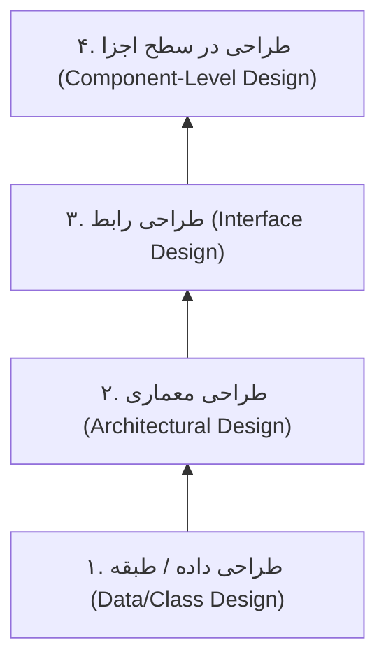

# 🏗️ فرآیند و جریان اطلاعات در طراحی نرم‌افزار

> [!info] تعریف کلیدی
> **طراحی نرم‌افزار (Software Design)** فرآیند تکرارشونده‌ای است که طی آن **نیازمندی‌ها (Requirements Model)** به یک **نقشه ساخت (Blueprint)** دقیق برای پیاده‌سازی و کدنویسی تبدیل می‌شوند.

## 🖼️ جریان تبدیل مدل الزامات به مدل طراحی (تصویر ۱-۹ جزوه / Figure 9.1)
![[fig_9_1_design_flow.png]]

### تشریح چهار مدل/لایه طراحی (هرم طراحی از پایین به بالا):
اطلاعات استخراج‌شده از [[مدیریت نیازمندی‌ها|مدل الزامات]] (عناصر سناریومحور، طبقه‌محور، جریان داده و رفتاری) به **چهار عنصر اصلی مدل طراحی** تبدیل می‌شوند:

1. **طراحی داده / طبقه (Data / Class Design):**
   - مدل‌های تحلیل (مانند ERD و نمودار کلاس) را به ساختمان داده‌ها، جداول پایگاه داده و کلاس‌های طراحی تبدیل می‌کند.
2. **طراحی معماری (Architectural Design):**
   - روابط بین عناصر ساختاری اصلی نرم‌افزار، زیرسیستم‌ها و سبک‌های معماری را تعریف می‌کند (نقشه کلی ساختمان نرم‌افزار).
3. **طراحی رابط (Interface Design):**
   - چگونگی ارتباط نرم‌افزار با خود و دنیای بیرون را مشخص می‌کند و شامل **سه نوع رابط** است:
     1. رابط کاربری (UI)
     2. رابط‌های خارجی (ارتباط با سایر سیستم‌ها و سخت‌افزارها)
     3. رابط‌های داخلی (ارتباط بین ماژول‌ها و اجزای طراحی)
4. **طراحی در سطح اجزا (Component-Level Design):**
   - عناصر ساختاری معماری را به توصیف رویه‌ای و الگوریتمی اجزای نرم‌افزاری (توابع، متدها و منطق داخلی) تبدیل می‌کند.

## ⭐ ویژگی‌های کیفیت طراحی (مک‌گلاگلین - McGlaughlin)
1. طراحی باید تمام نیازمندی‌های صریح مدل الزامات را پیاده‌سازی کند و نیازمندی‌های ضمنی مشتری را نیز برآورده سازد.
2. طراحی باید یک راهنمای خوانا و قابل درک برای تولیدکنندگان کد، آزمایش‌گران و تیم پشتیبانی باشد.
3. طراحی باید تصویری کامل از نرم‌افزار (شامل داده‌ها، عملکرد و رفتار) از دیدگاه پیاده‌سازی ارائه دهد.

## 💳 بدهی فنی (Technical Debt) و تنوع و همگرایی (Diversification & Convergence)
* **بدهی فنی (Technical Debt):** هزینه‌ها و مشکلات پنهانی که در آینده به دلیل انتخاب راه‌حل‌های سریع، شکننده یا طراحی ضعیف در زمان حال به پروژه تحمیل می‌شود (مشابه بهره وام که اگر بازپرداخت نشود، نگهداری سیستم را فلج می‌کند).
* **تنوع و همگرایی (Diversification & Convergence):** برای رسیدن به طراحی بهینه، مهندس ابتدا با **تنوع** گزینه‌های مختلف طراحی را بررسی می‌کند و سپس با **همگرایی** و ارزیابی آن‌ها بر اساس محدودیت‌ها، بهترین گزینه را انتخاب می‌کند.

## 🔗 ارتباط با سایر مفاهیم
* [[مفاهیم بنیادین و اصول مدل‌سازی طراحی]]
* [[طراحی معماری و نمودار استقرار UML]]
* [[طراحی مبتنی بر الگو (Pattern-Based Design)]]
* [[تضمین کیفیت، بررسی فنی (TR) و اصول آزمون]]

> [!warning] نکات امتحانی
> * **چهار عنصر مدل طراحی در تصویر ۱-۹ جزوه به ترتیب:** ۱. طراحی داده/طبقه ۲. طراحی معماری ۳. طراحی رابط ۴. طراحی سطح اجزا.
> * **انواع رابط در طراحی رابط:** رابط کاربری، رابط خارجی و رابط داخلی.
> * کیفیت نرم‌افزار در **مرحله طراحی** پایه‌گذاری می‌شود؛ طراحی خوب در برابر تغییر مقاوم است.
